<p align="center">
  
</p>

<p align="center">
  <b>Everything you can watch, in one place, starting with what fits your taste.</b><br>
  A TV-first streaming front end for your Jellyfin server, Netflix and Seerr, with recommendations made for each profile.
</p>

<p align="center">
  <a href="https://github.com/Gandalfoy63/dholphin-releases/releases/latest"></a>
  <a href="https://hub.docker.com/r/gandasdevstudio/dholphin"></a>
  <a href="https://hub.docker.com/r/gandasdevstudio/dholphin"></a>
</p>

<p align="center">
  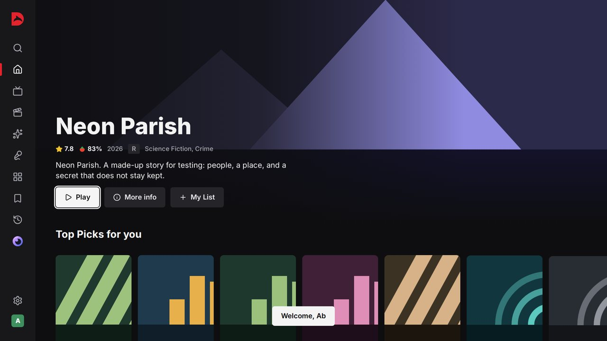
</p>

> The screenshots use made-up titles and drawn artwork from the test suite. With your keys, Dholphin shows real films, series and posters from TMDB.

---

## What it is

Dholphin brings what you can watch into one remote-friendly app, built for the couch:

- **Your Jellyfin server**: plays films and series with the right audio and subtitles, resumes where you stopped, offers the next episode.
- **Netflix**: on Android TV, hands the title to the Netflix app; elsewhere, opens it on Netflix's own site.
- **Seerr**: asks for what nobody has yet, a whole series or season by season, in the name of whoever asks.
- **TMDB, OMDb and more** for the catalogue: IMDb, Rotten Tomatoes and Metacritic scores, casts, trailers, and lists from AniList, MyAnimeList, TVmaze and Trakt.

Every row is ordered for the profile watching: what you liked, loved, finished or said no to shapes what comes first, and Home looks a little different every time you open it.

## Highlights

<table>
<tr>
<td width="50%">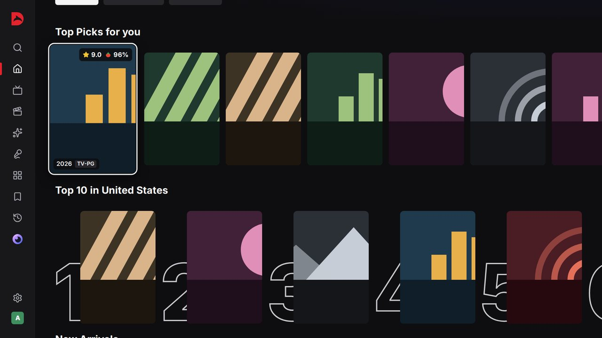<br><b>Grades at a glance.</b> One overall grade from every source, the Rotten Tomatoes score beside it, loaded before you reach the card.</td>
<td width="50%">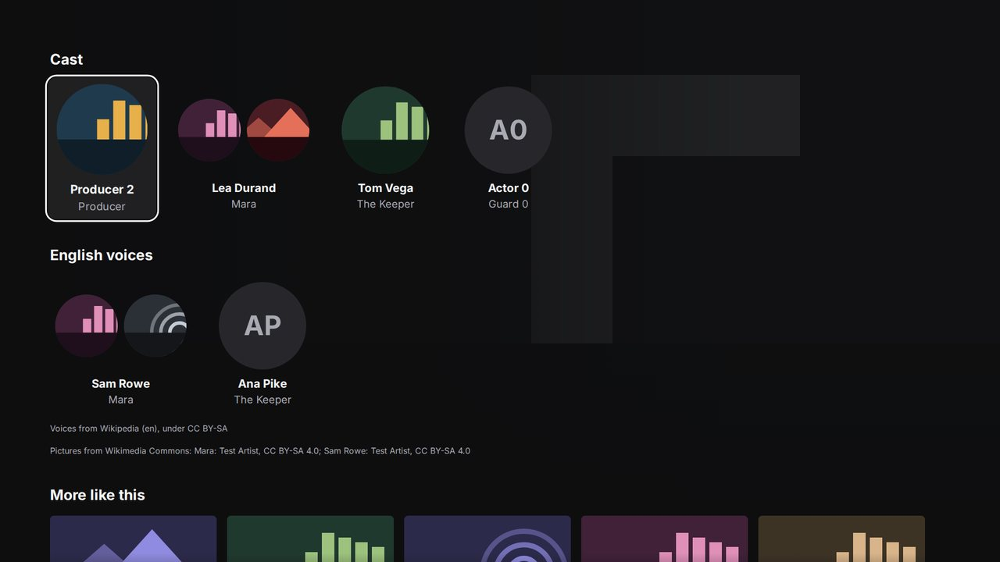<br><b>Cast and voices.</b> The cast with its characters, and the dubbing voices in your language, from Wikipedia and Wikidata.</td>
</tr>
<tr>
<td>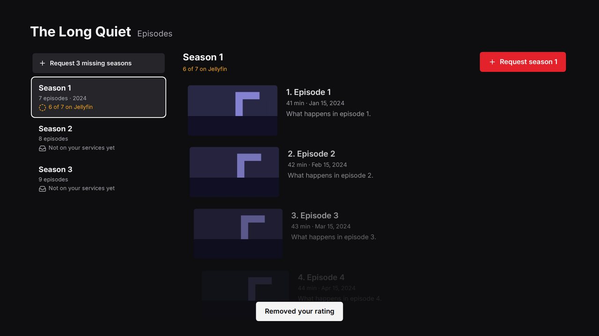<br><b>Episodes, season by season.</b> What your server has, what is missing, and a request for a whole season in one press.</td>
<td>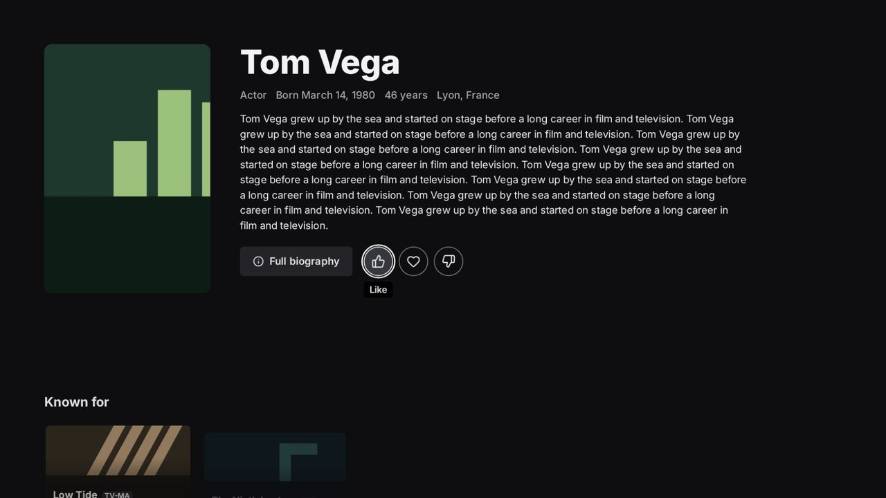<br><b>Actor pages.</b> Photo, biography, known for, photos; like an actor and their films show up on Home.</td>
</tr>
<tr>
<td>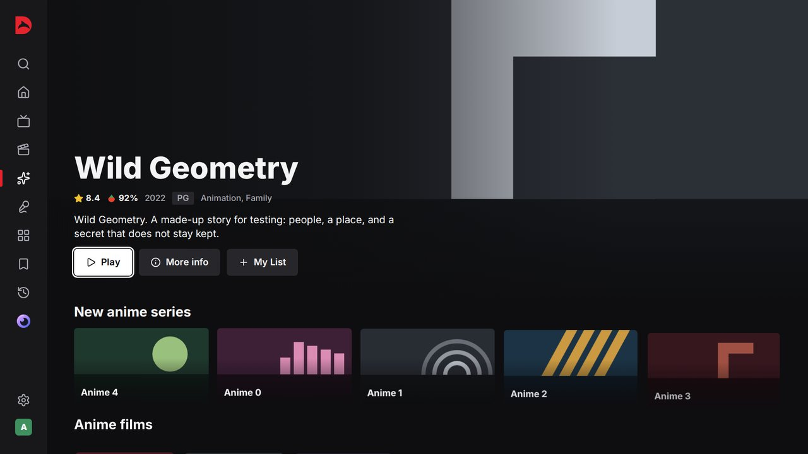<br><b>Anime and TV Shows</b> have their own pages, so talk shows and reality TV never crowd your series.</td>
<td>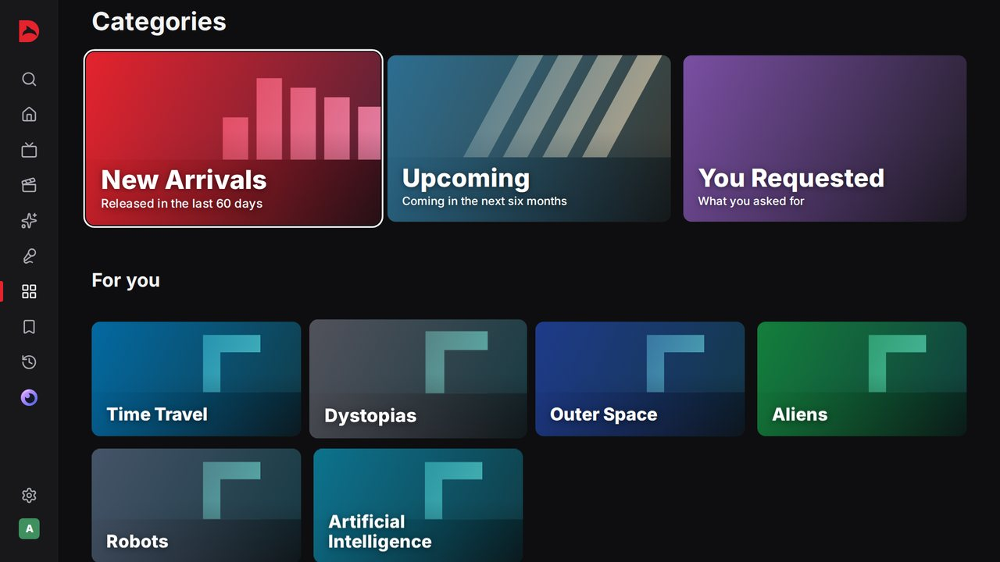<br><b>Categories</b> that go deeper as you scroll: by month, by decade, hidden gems, then every title, sorted for you or by grade.</td>
</tr>
<tr>
<td>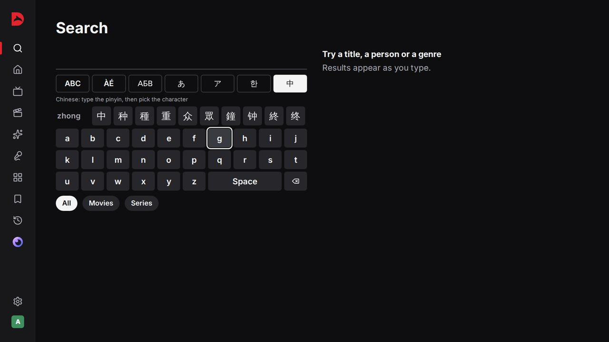<br><b>A keyboard for every script.</b> Latin, accents, Cyrillic, Japanese kana, Korean Hangul and Chinese from pinyin.</td>
<td>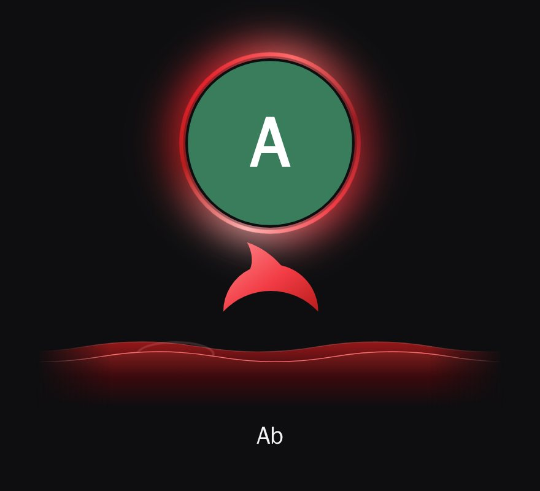<br><b>Profiles</b> with a famous actor's photo, their own Jellyfin account and their own history, list and taste.</td>
</tr>
</table>

In English, French, Spanish, German and Italian.

## Run it

Dholphin runs on its own on each TV, or with a **Dholphin server** that keeps the household's profiles, history and keys for every device, serves the app to browsers, and caches film data and pictures so pages load fast.

| Where | How |
|---|---|
| **Android TV** | Install the APK from the [latest release](https://github.com/Gandalfoy63/dholphin-releases/releases/latest). The app updates itself. |
| **CoolDash OS** | Install Dholphin from the CoolDash marketplace. |
| **Server and web app** | Docker, below: [gandasdevstudio/dholphin](https://hub.docker.com/r/gandasdevstudio/dholphin) |

### The server with Docker

```yaml
# compose.yml
services:
  dholphin:
    image: gandasdevstudio/dholphin:latest
    container_name: dholphin
    restart: unless-stopped
    ports: ["8080:8080"]
    volumes: ["dholphin-data:/data"]
volumes:
  dholphin-data: {}
```

```sh
docker compose up -d
docker logs dholphin        # shows a one-time setup code
```

Open `http://<your-server>:8080/panel`, enter the setup code and choose the household password. In the panel you then add the film data keys, your Jellyfin and Seerr addresses, the profiles and each one's Jellyfin account, and link TVs with a six-digit code.

<p align="center">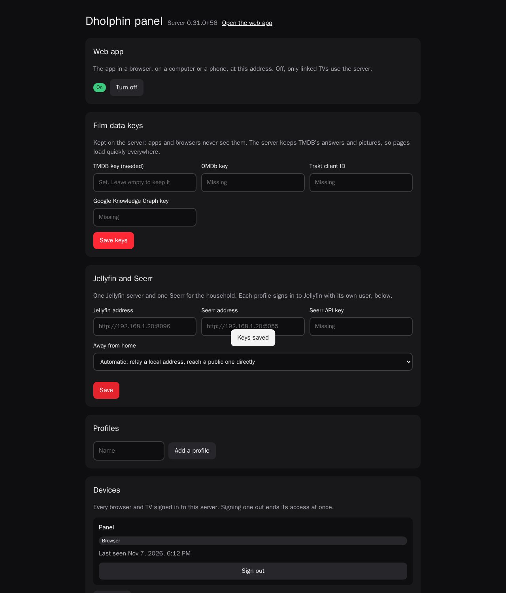</p>

**On the internet**, behind Traefik with HTTPS: use [`docker/compose.traefik.yml`](docker/compose.traefik.yml) and set `DHOLPHIN_DOMAIN` (and `TRAEFIK_NETWORK`, `TRAEFIK_RESOLVER`) in `docker/.env`, from [`docker/env.example`](docker/env.example). Set `TRUST_PROXY=1` when a proxy sits in front.

Away from home, the server relays Jellyfin and Seerr when their address is a local one, so only Dholphin needs to be reachable from outside; a public Jellyfin address is used directly. Both can be forced in the panel.

### Linking a TV

On the TV: **Settings → Link to a Dholphin server**, then the server's address and the code from the panel. A TV linked to a fresh server shows the panel's QR code and moves on by itself once a profile exists.

<p align="center">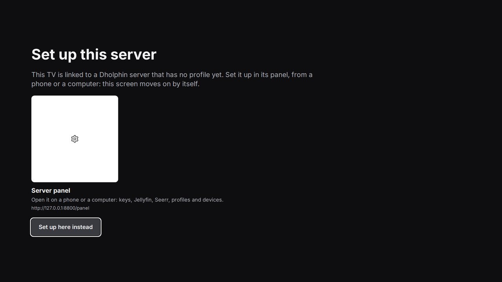</p>

### Keys

| Key | Needed | Where |
|---|---|---|
| TMDB | Yes, free | themoviedb.org/settings/api |
| OMDb | For IMDb, Rotten Tomatoes and Metacritic | omdbapi.com/apikey.aspx |
| Trakt | For Trakt's lists and scores | trakt.tv/oauth/applications/new |
| Google Knowledge Graph | For more actor photos | console.cloud.google.com |

On a server, keys stay on the server: apps and browsers only get placeholders. On a TV running on its own, they can be typed on a phone by scanning a QR code.

## Privacy and limits

- No DRM is bypassed, no stream is captured or downloaded. Netflix plays in Netflix's own app or site, signed in by you.
- The server keeps one household password (scrypt), a token per device that can be signed out from the panel, and never sends its keys to a client.
- Profiles, history, lists and ratings stay on your devices or your own server. The app only asks the film data services (TMDB, OMDb and the others above) about titles; with a server, it asks through the server.

## Build from source

Needs Node.js 24, Rust with the `wasm32-unknown-unknown` target, and Docker for the browser tests.

```sh
npm ci
tools/pack_cooldash.sh          # builds the web app, the Rust core (WebAssembly) and the CoolDash package
tools/build_server.sh           # builds the server image, dholphin:latest
tools/build_android.sh          # builds the Android TV APK (Android SDK needed)

npx tsc --noEmit && npx vitest run && cargo test
tools/test_e2e.sh               # the app driven by keyboard in a real browser, against stand-in services
```

| Folder | What is inside |
|---|---|
| `src/` | The app: TypeScript, no framework. `core/` the catalogue, taste and data, `ui/` the screens |
| `crates/` | The Rust core, compiled to WebAssembly: ranking, taste, normalising TMDB |
| `providers/` | Jellyfin and Seerr, Netflix |
| `hosts/` | Where it runs: browser, Android TV, CoolDash OS |
| `server/` | The Dholphin server (Node.js, no dependencies) and its panel |
| `android/` | The Android TV app (Kotlin WebView) |
| `docker/` | The image and the Compose files |
| `tests/` | Unit tests and the end-to-end tests with stand-in services |

## Credits

Film and series data from [TMDB](https://www.themoviedb.org). This product uses the TMDB API but is not endorsed or certified by TMDB. Streaming availability from JustWatch, through TMDB. Scores from OMDb; lists from AniList, Jikan (MyAnimeList), TVmaze and Trakt; casts and voices from Wikidata, Wikipedia and Wikimedia Commons. Icons by [Lucide](https://lucide.dev). Typeface [Inter](https://rsms.me/inter/). Jellyfin, Netflix and Seerr names and logos belong to their owners and are used only to say where a title plays.

## License

No license has been chosen yet: all rights reserved by the author.
